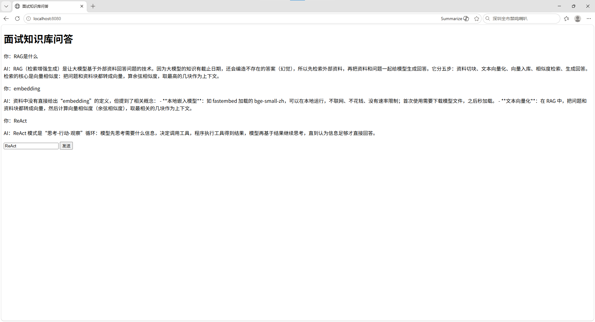

# AI 面试知识库问答系统

## 项目简介
    大模型有知识截止日期且会编造答案（幻觉），直接问不可靠。
本项目实现了一个基于 RAG 的知识库问答系统：问题进来先做本地语义检索，
把相关资料和问题一起交给大模型生成回答——答不出会直说，不瞎编。
另附岗位匹配 Agent：输入你的技能，自动搜真实岗位、算匹配度、列补齐方案、生成面试题。
全程零 API 成本、数据不出本地，浏览器打开即用。

## 环境配置
1. 注册通义千问（或 DeepSeek），创建 API key
2. 复制 `config.example.py` 为 `config.py`，把 key 填进去（`config.py` 已被 .gitignore 忽略，不会泄露）

## 功能
1. 本地语义检索（知识库覆盖范围内的问题都能答，答不出会说"资料里没有"，不瞎编）
2. 网页聊天界面（浏览器打开就能用）
3. 岗位匹配 Agent（输入技能：搜真实岗位、算匹配度、列补齐方案、生成面试题）
4. 支持多模型切换（DeepSeek / 通义，改 config.py 就行）

## 技术栈
- Python / FastAPI（后端服务）
- fastembed + BGE 中文向量模型（本地语义检索）
- LangChain / LangGraph / OpenAI 兼容协议（大模型调用 + Agent 编排）
- HTML + JavaScript（网页前端）

## 怎么运行
1. cd 到项目目录（README.md 所在文件夹）
2. pip install -i https://pypi.tuna.tsinghua.edu.cn/simple fastapi uvicorn fastembed langchain-openai
3. 复制 `config.example.py` 为 `config.py` 并填入你的 API key
4. python rag_api.py
5. 浏览器打开 http://localhost:8080

## 项目结构
rag_api.py           后端服务（/chat 问答接口 + /match 岗位匹配接口 + 网页托管）
rag_embedding.py     核心 RAG 逻辑（切块/向量化/检索）
job_match_agent.py   岗位匹配 Agent（LangGraph：搜岗/算匹配/解析简历/面试题/联网）
config.example.py    密钥配置模板（复制为 config.py 后填 key）
static/index.html    前端页面（双 Tab：知识库问答 | 求职助手）

## 效果演示

## 核心亮点
1. 全本地语义检索：bge-small-zh 中文向量模型，零 API 成本、无速率限制、数据不出本地
2. 检索调优：实测 top_k 2/3/4，发现过小会"资料里有却答不出"（召回不足）、过大引入噪声，最终定为 4
3. 多模型容灾：DeepSeek 宕机时四层排查定位根因，靠 OpenAI 兼容协议一行配置切换 qwen，服务零中断
4. 解决 file:// 跨域白屏：改用 FastAPI 静态托管同源访问，一个端口对外可访问
5. 岗位匹配 Agent：LangGraph 编排 5 个工具（搜岗/算匹配/解析简历/面试题/联网搜真实岗位），输入技能自动完成"搜岗 → 算匹配 → 列差距 → 给方案"全流程

## 待办
- [x] 接入岗位匹配 Agent（已完成：/match 接口 + 网页"求职助手"Tab）
- [ ] 流式输出（边生成边显示，体验更好）

